<div align="center">


<br/>


<br/><br/>

<a href="https://github.com/pawanch67192-arch">

</a>

</div>


<div align="center">

### 「 THE DEVELOPER PROFILE 」

*Every great creation starts with curiosity.*

</div>

### ◈ Character Information

```yaml
name: Pawan Chauhan
username: pawanch67192-arch
role: Student Developer
education: B.Tech CSE (AI/ML)
college: K.R. Mangalam
location: Gurugram, Haryana, India

interests:
  - Artificial Intelligence
  - Machine Learning
  - Web Development
  - Generative AI
  - Competitive Programming

current_mindset: Learn → Experiment → Create
```

### ◈ About My Journey

Hey! I'm **Pawan Chauhan**, a Computer Science student specializing in Artificial Intelligence and Machine Learning.

I'm interested in the intersection of software development and intelligent technology. I enjoy exploring new tools, understanding how things work, and turning ideas into functional projects.

My current interests include:

- 🌐 Building interactive web experiences
- 🤖 Exploring Artificial Intelligence and Machine Learning
- 📊 Understanding data through Python libraries
- 🧩 Improving my programming and problem-solving skills

> *I believe every line of code is an opportunity to learn something new.*


<div align="center">

### ✧ THE INVENTORY ✧

*Technologies equipped in my developer toolkit*

</div>

<details open>
<summary><b>◈ Frontend Arsenal</b></summary>
<br/>


HTML5 · CSS3 · JavaScript · React.js · Tailwind CSS

</details>

<details open>
<summary><b>◈ Backend Arsenal</b></summary>
<br/>


Node.js · Express.js · Python · Java

</details>

<details open>
<summary><b>◈ Database Storage</b></summary>
<br/>


MongoDB · MySQL

</details>

<details open>
<summary><b>◈ AI & Data Toolkit</b></summary>
<br/>


</details>

<details open>
<summary><b>◈ Development Equipment</b></summary>
<br/>


Git · GitHub · VS Code · Postman · Vercel · Netlify · Figma · Canva

</details>


<div align="center">

### ✧ CURRENT QUESTS ✧

| Quest | Focus |
|:--|:--|
| 🤖 AI Exploration | Artificial Intelligence & Machine Learning |
| 🌐 Web Creation | Frontend and web development |
| ✨ Generative AI | Exploring generative technologies |
| 🧩 Problem Solving | Competitive programming |

*The journey is ongoing. More knowledge, more experiments, more creations.*

</div>


<div align="center">

### ✧ GITHUB CHARACTER STATS ✧

*My public coding activity*

<br/>

<a href="https://github.com/pawanch67192-arch">

</a>
<a href="https://github.com/pawanch67192-arch">

</a>

<br/><br/>


<br/><br/>


</div>


<div align="center">

## ✦ SPACE MISSION CONTROL ✦



<br/>


*Exploring new technologies, one project at a time.*

<br/>


</div>


<div align="center">

### ✧ FIND ME IN THE DIGITAL WORLD ✧

<a href="https://github.com/pawanch67192-arch">

</a>
<a href="https://www.linkedin.com/in/pawan-chauhan-710a513a6/">

</a>
<a href="mailto:pawan.ch67192@gmail.com">

</a>

<br/><br/>


<br/>

**`while (learning) { keepBuilding(); }`**

<br/>

<sub>Designed with curiosity · Powered by coffee and code ☕</sub>


</div>
